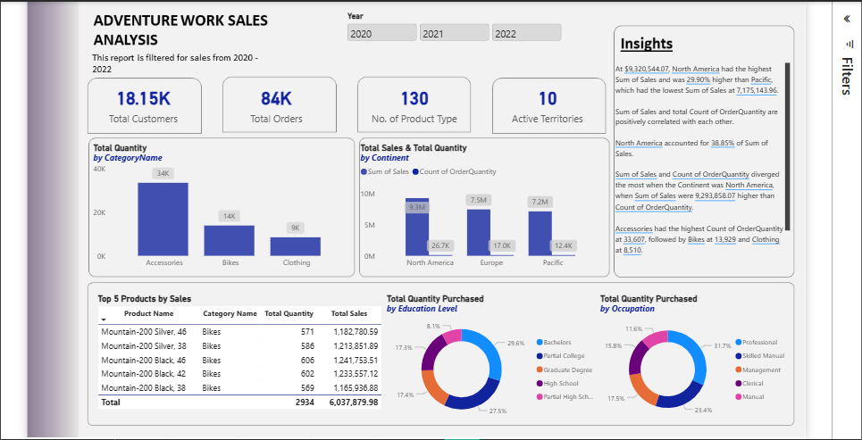

# AdventureWorks Sales Analysis | PostgreSQL & Power BI

Project from the **Women Techsters Fellowship** (Data Science & Engineering, Class A), Tech4Dev,.

## Business problem
Adventure Works is a global retail and manufacturing company. Management needed clearer insight into customer behavior, product performance and sales trends across countries and territories. This project builds a clean relational database in PostgreSQL, answers 15 business questions with SQL, and presents the results in a Power BI dashboard covering sales from 2020 to 2022.

## Tools
PostgreSQL, SQL (JOINs, CTEs, subqueries, aggregations, views), Power BI, Power Query, Excel

## Key findings
- **About $24M** in total sales across 2020-2022, from **18.15K customers**, **84K orders**, **130 product types** and **10 active territories**.
- **North America** led sales at **$9.32M (38.85% of total)**, about 29.9% higher than the Pacific region ($7.18M).
- **Accessories** had the highest order quantity (33,607), followed by Bikes (13,929) and Clothing (8,510), while the top five products by sales were all **Mountain-200 bikes**, together worth about **$6.04M**.
- **1,499 customers** placed orders in Canada.
- Customers who ordered after 2021 and total quantity purchased were broken down by occupation and education level to show who the buying groups are.

## Recommendations from the team
- Focus marketing and stock on top performers, especially Bikes
- Investigate high-return items for quality issues
- Create loyalty programs for high-value, high-frequency customers
- Strengthen presence in Canada and Australia
- Use bundles to increase average order value
- Reposition or adjust pricing for weaker categories such as Clothing

## Approach
1. **Database setup:** created tables for customers, sales (2020-2022), products, categories, territories and returns.
2. **Cleaning and transformation:** combined name fields into a full name and replaced coded values (M/S, M/F, Y/N) with readable labels for marital status, gender and homeowner.
3. **Unified sales view:** combined the three yearly sales tables with `UNION ALL` into `adv_sales_all`.
4. **Business questions:** answered 15 questions, for example revenue by product category, customers who ordered in more than one territory, the 10 most-returned products with net revenue, and the top 50 customers of 2022 by revenue.
5. **Reporting layer:** created SQL views for KPIs (total revenue, quantity, returns, customers) and slicers, then built the Power BI dashboard.

## Repository contents
| Path | What it is |
| --- | --- |
| `sql/adventureworks_analysis.sql` | Table creation, transformations, 15 business queries, KPI and slicer views |
| `powerbi/AdventureWorks_Report.pbix` | Power BI dashboard (data is imported into the file) |
| `images/` | Dashboard and query screenshots |

## My role
I wrote the SQL queries, did the data cleaning and transformation, and helped build the Power BI dashboard.

## Data
The AdventureWorks dataset was provided by our fellowship instructor. It is a public Microsoft sample dataset, and the raw CSV files are not included in this repository.

## How to reproduce
1. Create the database and tables from `sql/adventureworks_analysis.sql`.
2. Import the AdventureWorks CSV files into the matching tables.
3. Run the transformation and query sections in order.
4. Open the `.pbix` file in Power BI Desktop and refresh the report.

## Limitations
- No promotion or discount data, so price-driven behavior could not be assessed
- No shipping or delivery data, so fulfillment performance could not be evaluated
- No return reasons, so the drivers behind high-return items are unclear
- No linked profit data, so profit margins could not be analyzed accurately
